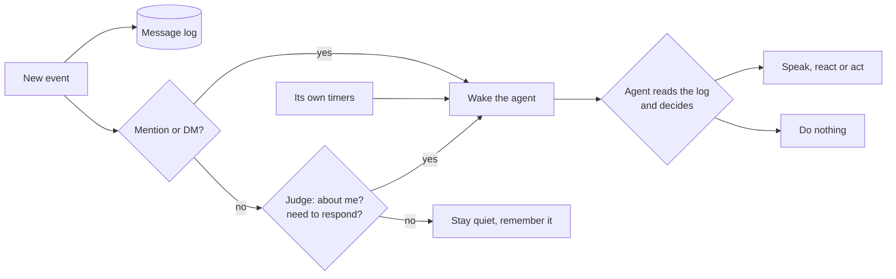
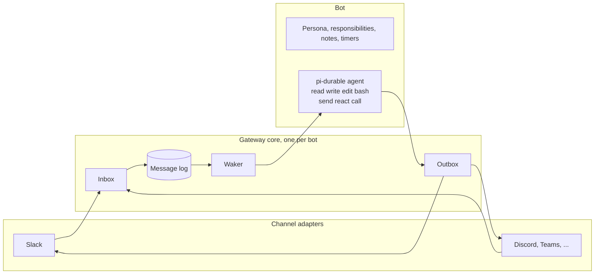

<div align="center">


# pi-durable-bot (Pots)

**The open-source AI coworker that acts on its own.**

It reads every channel, email and event you give it, decides what matters,<br>
does the work on its own computer, and speaks up when it should.

[Demo](#see-it-work) · [Quick start](#quick-start) · [How it decides](#how-it-decides-to-act) · [Open and yours](#open-and-yours) · [How it works](#how-it-works)

[](LICENSE)
[](https://github.com/earendil-works/pi)
[](https://chat-sdk.dev)
[](https://nodejs.org)

</div>

<p align="center" id="see-it-work">
  <a href="docs/media/demo.mp4"></a>
</p>

Grok Bot, dots and Claude Tag showed what an AI teammate can be. pi-durable-bot gives you the same kind of coworker as open source: it runs on your machine, with the model you choose, in the places your team already talks.

## Not a bot. A coworker.

Most AI bots are a command line with a chat bubble. You @ them, they answer, they forget. A real coworker works differently:

| | A chat bot | pi-durable-bot |
|---|---|---|
| **What it sees** | The message that mentions it | Everything in the places it was invited to: chats, DMs, emails, events, pages it watches |
| **When it acts** | When you @ it | When it decides it should. It can also answer when you @ it |
| **What it remembers** | This thread, maybe | One long memory across every channel, kept on disk |
| **How it works** | Calls the tools someone wired in | Writes and runs its own code on its own computer |
| **What happens later** | Nothing | It sets its own reminders and comes back |
| **After a crash** | Starts over, or sends twice | Picks up where it stopped. Never sends the same message twice |

## What it does

### 📥 Its own inbox

Every message in every place you invite it to lands in one inbox: channel messages that never mention it, edits, deletions, reactions, people joining, and its own messages. It keeps all of it in a local SQLite log and reads that log with SQL whenever it needs context. Nothing is thrown away when a conversation gets long.

### 🧠 Its own judgment

It is woken in three ways, the same three ways a person notices work:

| | Like a coworker who... | How |
|---|---|---|
| **Someone asks** | gets a message or an @ | A mention or a DM wakes it at once (after a short pause, so you can finish typing) |
| **It notices** | overhears something that is their job | A judge reads each message that does not mention it and asks two questions: *is this about me?* and *should I respond?* It sees the bot's own list of responsibilities. The judge is the bot's own model, a fast classifier such as TypeSafe's Jev, or a local model |
| **It checks in** | looks around now and then, and keeps promises | It sets its own timed wakes: "check Acme's pricing every Monday", "follow up at 5 pm". If it has none, it looks around every two hours |

Being woken is not the same as speaking. Each time, the agent reads the log and decides if it should say anything, where, and when. Most of the time the right answer is to stay quiet.

### 💻 Its own computer

It has a real machine with a shell, a browser it can drive, files and the internet. It does not wait for a plugin. It writes the script it needs, runs it, fixes it, and keeps the useful ones. That covers research, spreadsheets, reports, monitoring a web page, filling a form, or booking a flight, and also code.

This is **code mode**: the agent gets a few general tools (`read`, `write`, `edit`, `bash`) plus three channel actions (`send`, `react`, `call`), and builds the rest itself.

### 💬 Its own voice

When it speaks, it speaks like a teammate: in the right channel or thread, in its own words, with the file attached. It can reply in a thread, start a new message, DM a person, add a reaction, edit its own message, or call any other platform API.

### ⏰ Its own schedule

It promises to come back, and it does. Timed wakes live in the same database as everything else, so they survive restarts. It can also add normal cron jobs on its machine.

### 📓 Its own memory

Each bot has one long conversation, across every channel. When the context gets full, the bot decides when to **turn the page**: it writes notes for itself, starts a fresh context, and the notes come with it. The full message log stays on disk, so nothing is lost. Its persona, its responsibilities and its notes are plain files it edits itself.

### 🛟 Durable by design

Built on [pi-durable](https://github.com/earendil-works/pi), every step is journaled. Kill the process in the middle of a task and it continues after restart. Every incoming event is written to disk before it is acknowledged. Every outgoing message carries a send ID, and after a crash the bot checks whether the message already went out before it sends again.

## Open and yours

Grok Bot, dots, Muse and Claude Duet are closed products. They run on someone else's computer, with someone else's model, inside the apps they chose. pi-durable-bot is MIT-licensed and runs where you put it.

| | Closed AI coworkers | pi-durable-bot |
|---|---|---|
| Source code | Closed | Open, MIT |
| Where it runs | The vendor's cloud | Your server, your VM, your office box |
| Model | The vendor's | Your subscription login, any of 40+ providers, or a local model |
| Your data | Sent to the vendor | Stays on your machine in one SQLite file per bot |
| Channels | The ones the vendor supports | Any channel with a [Chat SDK](https://chat-sdk.dev) adapter |
| Custom work | What the vendor allows | Anything. Change the code, add tools, connect your own systems |

**Any model.** Log in once with a subscription you already pay for, use an API key from any of the 40+ providers [pi](https://github.com/earendil-works/pi) supports, point it at any OpenAI-compatible endpoint (vLLM, SGLang, a proxy), or run a local model with Ollama, LM Studio or llama.cpp. The bot uses pi's own model layer, so every model pi can use, the bot can use. With a local model for the agent and the judge, nothing leaves your machine. You are not locked to one model vendor.

**Any channel.** The core speaks in five plain words: channel, place, thread, message, person. Platform details stay inside one adapter per platform, so adding Discord, Teams, Telegram or email is one adapter, not a rewrite. One bot can be in many channels and stays the same person everywhere.

**Your business.** Give it your own tools, data and workflows. It can run several bots on one machine, each with its own name, persona, responsibilities and memory. A bot can even edit its own definition, or create a new bot.

## Quick start

> [!IMPORTANT]
> The bot gets full control of the machine it runs on, with no approval step. Give it a machine or VM of its own.

**The fast way:** point your coding agent at this repository.

```text
Set up https://github.com/Crokily/pi-durable-bot on this machine and connect it to my Slack workspace.
```

**By hand** (Linux with systemd, Node.js 24 or newer):

1. Install [pi](https://github.com/earendil-works/pi) and log in once with your subscription or an API key. The bot uses the same login.
2. Clone and install:
   ```sh
   git clone https://github.com/Crokily/pi-durable-bot && cd pi-durable-bot
   npm ci
   ```
3. Create a Slack app from [`docs/slack-app-manifest.yaml`](docs/slack-app-manifest.yaml) and put its tokens in `~/.config/pi-durable-bot/slack.env`:
   ```sh
   SLACK_APP_TOKEN=xapp-...
   SLACK_BOT_TOKEN=xoxb-...
   ```
4. Create your coworker:
   ```sh
   node scripts/new-bot.ts pots --name Pots --slack ~/.config/pi-durable-bot/slack.env \
     --persona "Calm, direct, a little dry." \
     --responsibilities "Pricing, competitors, and keeping the team's travel sorted."
   ```
5. Run it as a service, then invite it to the channels it should work in:
   ```sh
   ./scripts/deploy.sh
   ```

It joins only the places it is invited to, like a new hire who is added to the right channels.

### Choose the models

`bot.json` names two models. Both use pi's logins and model list, so `pi` shows what is available.

| Field | What it does | Values |
|---|---|---|
| `model` | The agent that reads, thinks and acts | Any pi model as `provider/modelId`, for example `openai/gpt-6.1-sol` or `anthropic/claude-opus-5-5` |
| `judge` | Decides which messages that do not mention the bot should wake it | `main` (default): the bot's own model judges, no extra account<br>`provider/modelId` of a classifier: `typesafe/jev-latest`, `openrouter/typesafe/jev-1.14`, `opencode/jev-1.13-free`, or a llama.cpp model<br>`off`: every message wakes the bot, and the agent decides |

A fast classifier is cheaper and quicker than the main model: Jev answers in about 0.3 seconds. With `main`, each group of messages costs one short request to the main model.

**OpenAI-compatible and local endpoints** (Ollama, LM Studio, vLLM, a proxy) go in pi's `~/.pi/agent/models.json`, the same file the pi CLI reads ([fields](https://github.com/earendil-works/pi/blob/main/packages/coding-agent/docs/models.md)):

```json
{
  "providers": {
    "ollama": {
      "baseUrl": "http://localhost:11434/v1",
      "api": "openai-completions",
      "apiKey": "ollama",
      "compat": { "supportsDeveloperRole": false, "supportsReasoningEffort": false },
      "models": [{ "id": "qwen3:8b", "contextWindow": 32768 }]
    }
  }
}
```

Then set `"model": "ollama/qwen3:8b"`. The agent needs a model that calls tools well and a context window of 32K tokens or more.

**llama.cpp** can be both the agent and the judge. Start `llama-server` in router mode and run `pi`, then `/login llama.cpp` once ([guide](https://github.com/earendil-works/pi/blob/main/packages/coding-agent/docs/llama-cpp.md)). Its chat models appear as `llama.cpp/<model>`. For the judge, use a decision model such as [Kev-4B](https://huggingface.co/ggml-org/Kev-4B-GGUF) (3 GB), which answers through llama.cpp's `/v1/systemone`; any chat model also works as a judge.

```json
{ "model": "llama.cpp/Qwen3-4B-Instruct-2507-Q4_K_M", "judge": "llama.cpp/Kev-4B-Q4_K_M" }
```

## How it decides to act



- Messages that arrive close together are grouped: it waits 3 seconds after the last one (20 seconds at most) before it judges.
- If it is already working in a place, new messages there are handed to it as it works, so it can change course.
- The wake message says only where, who, why and when. The agent reads the content itself.

## How it works



| Layer | Job |
|---|---|
| Channel adapter | One per channel account. Translates events in and actions out, backfills what it missed. Platform concepts never leave this layer. |
| Gateway core | Inbox, message log, waker and outbox. The same for every platform. |
| Bot | Identity, persona, responsibilities, notes, timers, workspace and one long conversation. |
| Agent | [pi-durable](https://github.com/earendil-works/pi): runs the model, journals every step, owns the tools. |

Each bot is a folder in `~/.local/share/pi-durable-bot/<id>/`:

| File | What it is |
|---|---|
| `bot.json` | Name, model, judge, channel accounts, settings. Edits apply within seconds. |
| `persona.md` | Personality and voice. The bot maintains it. |
| `responsibilities.md` | What it is responsible for. The judge reads it. The bot maintains it. |
| `notes.md` | Notes it carries across pages. |
| `workspace/` | Its working directory. |
| `bot.sqlite` | Message log, timers and the agent's journal in one file. |

The `pb` command gives the bot (and its scripts and cron jobs) the same actions from a shell: `pb send`, `pb react`, `pb call`, `pb wake`, `pb context`, `pb turn-page`, `pb status`. Tokens stay inside the running gateway; the agent never sees them.

## Status

pi-durable-bot runs every day as a teammate in a real workspace. What works today and what is next:

- [x] Slack adapter (socket mode), with backfill after downtime
- [x] Mention, DM, judge and timer wakes, grouping, and steering
- [x] Code mode on its own machine, `pb` command line
- [x] Turning the page with notes, compaction as a fallback
- [x] Crash-safe inbox and outbox, tested with a forced crash mid-send
- [x] Several bots per machine, systemd service
- [x] Any model pi can use: subscription logins, API keys, OpenAI-compatible endpoints, local models
- [x] A judge you choose: the bot's own model, Jev or another classifier, a local llama.cpp model, or none
- [ ] More adapters: Discord, Teams, Telegram, email

## Built on

- [pi-durable](https://github.com/earendil-works/pi) for the durable agent runtime
- [Chat SDK](https://chat-sdk.dev) for channel adapters
- [pi](https://github.com/earendil-works/pi)'s model layer for logins, providers and local models
- [TypeSafe AI](https://typesafe.ai)'s Jev, one of the judges you can choose

## License

MIT. The demo video, music, sky images and logo in [`docs/media`](docs/media) were made for this project and use the same license.
