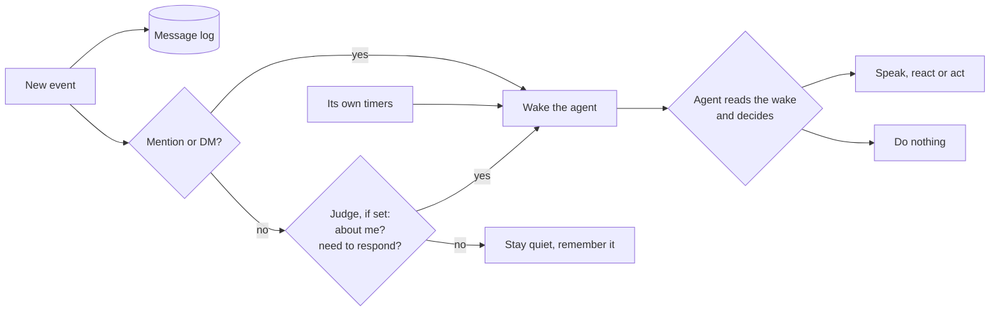
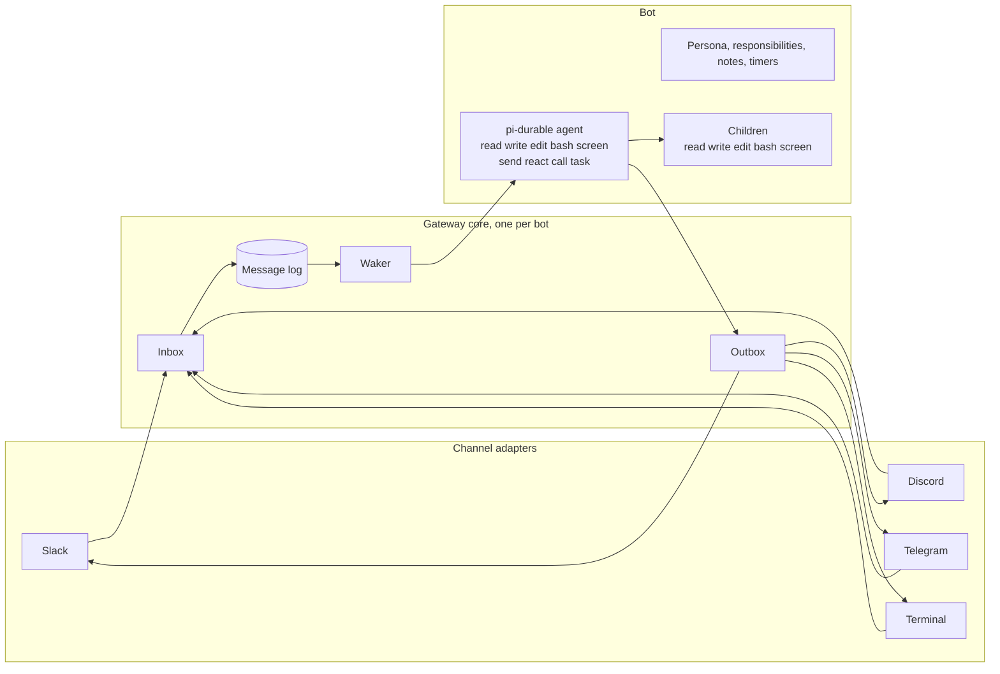

<div align="center">


# pi-durable-bot (Pots)

**The open-source AI coworker that acts on its own.**

It reads every channel, email and event you give it, decides what matters,<br>
does the work on its own computer, and speaks up when it should.

[Demo](#see-it-work) · [Quick start](#quick-start) · [How it decides](#how-it-decides-to-act) · [Open and yours](#open-and-yours) · [How it works](#how-it-works)

[](https://www.npmjs.com/package/pi-durable-bot)
[](#quick-start)
[](LICENSE)
[](https://github.com/earendil-works/pi)
[](https://chat-sdk.dev)
[](https://nodejs.org)

</div>

> [!TIP]
> **Setting this up with an AI agent, such as Claude Code, Codex or Cursor?** Have it read [docs/for-agents.md](https://github.com/Crokily/pi-durable-bot/blob/main/docs/for-agents.md) first. That page explains Pots to your agent and how to set it up. In short: the agent installs it and makes the bot, you sign in to your model with `pots login`, and then the bot connects Slack and your other apps itself.

<p align="center" id="see-it-work">
  <a href="docs/media/demo.mp4"></a>
</p>

Grok Bot, dots and Claude Tag showed what an AI teammate can be. pi-durable-bot gives you the same kind of coworker as open source: it runs on your machine, with the model you choose, in the places your team already talks.

## Not a bot. A coworker.

Most AI bots are a command line with a chat bubble. You @ them, they answer, they forget. A real coworker works differently:

| | A chat bot | pi-durable-bot |
|---|---|---|
| **What it sees** | The message that mentions it | Everything in the places it was invited to: chats, DMs, emails, events, pages it watches |
| **When it acts** | When you @ it | When it decides it should. It can also answer when you @ it |
| **What it remembers** | This thread, maybe | One long memory across every channel, kept on disk |
| **How it works** | Calls the tools someone wired in | Writes and runs its own code on its own computer |
| **What happens later** | Nothing | It sets its own reminders and comes back |
| **After a crash** | Starts over, or sends twice | Picks up where it stopped. Never sends the same message twice (on Telegram it can, [see why](#status)) |

## What it does

### 📥 Its own inbox

Every message in every place you invite it to lands in one inbox: channel messages that never mention it, edits, deletions, reactions, people joining, and its own messages. It keeps all of it in a local SQLite log and reads that log with SQL whenever it needs context. Nothing is thrown away when a conversation gets long.

### 🧠 Its own judgment

It is woken in three ways, the same three ways a person notices work:

| | Like a coworker who... | How |
|---|---|---|
| **Someone asks** | gets a message or an @ | A mention or a DM wakes it at once |
| **It notices** | overhears something that is their job | Every message that does not mention it comes to it too, and it decides itself whether it is about its work. You can also set a judge that reads these messages first and asks two questions: *is this about me?* and *should I respond?* It sees the bot's own list of responsibilities. The judge is a fast classifier such as TypeSafe's Jev, a local model, or the bot's own model |
| **It checks in** | looks around now and then, and keeps promises | It sets its own timed wakes and routines: "check Acme's pricing every Monday", "follow up at 5 pm". While no timed wake is pending, it looks around every two hours |

Being woken is not the same as speaking. Each time, the agent reads the log and decides if it should say anything, where, and when. Most of the time the right answer is to stay quiet.

### 💻 Its own computer

It has a real machine with a shell, files, the internet, and a screen it uses like a person: the browser and the apps on it, with the mouse and keyboard. It does not wait for a plugin. It writes the script it needs, runs it, fixes it, and keeps the useful ones. That covers research, spreadsheets, reports, monitoring a web page, filling a form, or booking a flight, and also code.

This is **code mode**: the agent gets a few general tools (`read`, `write`, `edit`, `bash`, `screen`) plus three channel actions (`send`, `react`, `call`), and builds the rest itself. One more tool, `task`, hands work to its helpers (below).

`screen` is `bash` with the screen's environment, such as `DISPLAY`; `bash` does not have it. A screen runs one task at a time, as a person's desktop does: the first `screen` command of an agent takes the screen until its work ends, also across bots and the Pots processes of the same user on the machine. Another agent that tries then learns who has it, since when, and when it frees, and decides itself what to do. A bot that sets up its own desktop, such as an Xvfb display, writes its environment into `screen` in its `bot.json`.

One agent at a time per screen is enforced only on Linux, where plain `bash` has no `DISPLAY` or `WAYLAND_DISPLAY` and so cannot reach the screen. On macOS and Windows the screen does not depend on those variables, so `bash` can still use it; there the agents use the `screen` tool because the prompt tells them to.

### 👥 Its own helpers

Longer work does not keep it from talking. With its `task` tool the bot starts **children**: agents that work in the background with `read`, `write`, `edit`, `bash` and `screen`, without the channel actions and `task`, on a brief it writes for them. It answers the person first, hands the work to a child, and stays free for the next message. A child starts from an empty conversation and its brief, so the bot's own context stays small; it sees the bot's memory index as it was when it started. When a child ends, done, failed or with a question for a person, its final message comes back to the bot as a wake, exactly once, also across crashes and restarts; the bot passes on what matters, and sends the child the answer to its question. While a child works for a place, new messages there go to the bot, so it can pass them on. Its timed and fallback wakes list the children that work and how long each has run. A stopped child reports nothing and does nothing more, also when the process dies in the middle of the stop.

Children use the bot's model, or the `childModel` of `bot.json`; a change counts for new children and those that exist, also when `childModel` is taken out. The bot chooses each child's thinking level when it starts it: `high`, `xhigh` or `max`, and without a choice the `childThinking` of `bot.json` (`xhigh` by default). A child keeps its level for its whole life, so a new `childThinking` counts for new children only; a level the model does not have becomes the nearest one it has, as in pi. `settings.maxChildren` (50 by default) caps how many work at once. `pots children` lists them, and `pots children --stop <id>` or `--stop-all` stops them.

It works like a [pi](https://github.com/earendil-works/pi) session: it reads `AGENTS.md` and uses [Agent Skills](https://agentskills.io) from the same places pi does, so the skills you give pi, the bot can use too. Screenshots and photos are shrunk to fit the model, as in pi.

### 💬 Its own voice

When it speaks, it speaks like a teammate: in the right channel or thread, in its own words, with the file attached. It can reply in a thread, start a new message, DM a person, add a reaction, edit its own message, or call any other platform API.

### ⏰ Its own schedule

It promises to come back, and it does. A timed wake (`pots wake`) wakes it once, at a time it chooses. A **routine** (`pots routine`) repeats: every 30 minutes, say, or on a cron schedule in the computer's time zone. Both live in the same database as everything else, so they survive restarts. It can also add normal cron jobs on its machine.

| Command | What it does |
|---|---|
| `pots routine add <name> (--every <duration> \| --cron "<expr>") (--note "<text>" \| --run "<command>") [--timeout <duration>]` | Add a routine, or replace the one with that name. Names are letters, digits, `-` and `_`; durations are as in `pots wake --in`: `90s`, `30m`, `2h`, `1d` |
| `pots routine list` | Each routine's schedule, what it does, its next time and its last run; and the fallback check-in |
| `pots routine remove <name>` | Remove a routine |

- `--note` wakes the bot with the note at each time. `--run` makes Pots run the command at each time, in the bot's shell, folder and environment, with `POTS_FROM` set to the routine's name. The command decides itself whether to wake the bot with `pots wake`, so watching an inbox every few minutes costs no model request until there is mail.
- A run is skipped while the last run of the same routine still runs. Times missed while the gateway was stopped or the computer was off or asleep are skipped, not made up: the next run is the next time from now.
- A command runs at most 10 minutes, or its `--timeout`; then Pots stops it and the processes it started. When the gateway stops, it stops the commands it runs.
- Pots keeps each run's start, end, exit code and last lines of output for 7 days. A failed run (a non-zero exit code, or the timeout) wakes the bot once, with that output; later failures of the same routine do not, until one of its runs succeeds.
- A script that calls `pots wake` says where the wake comes from with `--from <name>` (letters, digits, `-` and `_`), or `$POTS_FROM`. The wake then tells the bot that it comes from a command on this computer, not from a person, so outside text in its note, such as an email's subject, does not read as the bot's own plan. With `--id <id>`, a second `pots wake` with the same ID gives back the first wake and sets none, as `pots send --id` does.
- The fallback check-in (`fallbackWakeMinutes` in `bot.json`, 120 by default) comes while no wake set with `pots wake` is pending. Routines do not hold it back.

### 📓 Its own memory

Each bot has one long conversation, across every channel. Its **memory** works as Claude Code's automatic memory: plain markdown files, one per memory, and an index, `MEMORY.md`, that the bot sees at the start of every page and that points to them. The bot saves what is worth keeping (preferences, rules, facts about people and the work, decisions) when it sees it, and after each piece of work its own model, continuing the same conversation in the background, saves what it missed. That pass never sends a message or holds up a reply, its request starts as the bot's last one did, so the provider's prompt cache serves most of it, and code lets it change nothing but the memory. Once a day, after enough changes, a dream tidies the memory up the same way. The bot's next wake says what a pass or a dream changed; as in Claude Code, a restart before that wake loses the note, not the memory. A memory file read two days or more after it changed says how old it is. Each bot has its own memory, in `memory/` in its folder, and the bots of one computer share one more, in `~/.pots/memory/`, for facts about you. "Remember this" and "forget that" work by talking to it; to forget is to delete the file, as in Claude Code. `"settings": {"autoMemory": false}` in `bot.json` turns the memory off.

When the context gets full, the bot decides when to **turn the page**: it writes notes for itself, starts a fresh context, and the notes and the memory come with it. The full message log stays on disk, so nothing is lost. Its `AGENTS.md`, its responsibilities and its notes are plain files it edits itself.

### 🛟 Durable by design

Built on [pi-durable](https://github.com/earendil-works/pi), every step is journaled. Kill the process in the middle of a task and it continues after restart. Every incoming event is written to disk before it is acknowledged. Every outgoing message carries a send ID, and after a crash the bot checks whether the message already went out before it sends again.

## Open and yours

Grok Bot, dots, Muse and Claude Duet are closed products. They run on someone else's computer, with someone else's model, inside the apps they chose. pi-durable-bot is MIT-licensed and runs where you put it.

| | Closed AI coworkers | pi-durable-bot |
|---|---|---|
| Source code | Closed | Open, MIT |
| Where it runs | The vendor's cloud | Your server, your VM, your office box |
| Model | The vendor's | Your subscription login, any of 40+ providers, or a local model |
| Your data | Sent to the vendor | Stays on your machine, in each bot's folder |
| Channels | The ones the vendor supports | Any channel with a [Chat SDK](https://chat-sdk.dev) adapter |
| Custom work | What the vendor allows | Anything. Change the code, add tools, connect your own systems |

**Any model.** Log in once with a subscription you already pay for, use an API key from any of the 40+ providers [pi](https://github.com/earendil-works/pi) supports, point it at any OpenAI-compatible endpoint (vLLM, SGLang, a proxy), or run a local model with Ollama, LM Studio or llama.cpp. The bot uses pi's own model layer, so every model pi can use, the bot can use. With a local model for the agent and the judge, nothing leaves your machine. You are not locked to one model vendor.

**Any channel.** The core speaks in five plain words: channel, place, thread, message, person. Platform details stay inside one adapter per platform. Slack, Discord and Telegram work today; Teams or email is one more adapter, not a rewrite. One bot can be in many channels and stays the same person everywhere.

**Your business.** Give it your own tools, data and workflows. It can run several bots on one machine, each with its own name, persona, responsibilities and memory. A bot can even edit its own definition, or create a new bot.

## Quick start

> [!IMPORTANT]
> The bot gets full control of the computer it runs on, with no approval step. Give it a computer or VM of its own.

You need [Node.js](https://nodejs.org) 24 or newer, on macOS, Linux or Windows (with [Git for Windows](https://git-scm.com/download/win)).

```sh
npm install -g pi-durable-bot
pots init
```

`pots init` asks four things:

1. **Your bot's name.**
2. **Its AI.** Sign in with a subscription you already pay for (ChatGPT, Claude, GitHub Copilot, Grok, Kimi and more), use an API key, or point it at a local server (Ollama, LM Studio, llama.cpp).
3. **Who decides on group messages that do not mention it.** By default the bot itself: every such message wakes it. Or Jev, a fast judge from TypeSafe, with your TypeSafe API key, or a judge model you already set up in pi; the bot then wakes only for the messages about its work.
4. **In one sentence, what it is for.** Optional. The bot writes its own persona and responsibilities from it.

Then the gateway starts as a background service (it starts again at login) and you are talking to your bot in the terminal. It first checks that it can use the computer's screen and walks you through any permission it needs, such as Screen Recording and Accessibility on a Mac. On a server with no desktop, it works without a screen and asks you before it sets one up. Tell it which chat apps to join. It sets them up itself on its computer and asks you only for what it cannot do, like signing in to Slack or approving the app. Leave with Ctrl+C; come back with `pots chat`.

It joins only the places it is invited to, like a new hire who is added to the right channels.

| Command | What it does |
|---|---|
| `pots init` | Set up your first bot, or another one |
| `pots login` | Sign in to a model, or add an API key or a local server, for every bot on this computer; `--list` shows what can be used |
| `pots chat` | Talk to a bot in this terminal |
| `pots status` | The gateway, the service and each bot |
| `pots service install \| uninstall \| restart \| logs` | The gateway as a background service: launchd on macOS, systemd on Linux (`--system` for a server), Task Scheduler on Windows |
| `pots start` | Run the gateway in this terminal instead |
| `pots bot new \| list` | Create and list bots |
| `pots trace` | What a bot did: its last wakes, or one wake from the events to its run, the runs of the children it started, and the messages it sent, with how much of each model request the provider's prompt cache served |
| `pots children [--stop <id> \| --stop-all]` | The children a bot started for longer work, with each one's thinking level, or stop them |

To upgrade, run `npm install -g pi-durable-bot@latest`, then `pots service restart`. To remove it, run `pots service uninstall`, then `npm uninstall -g pi-durable-bot`. The bots stay in `~/.pots/` until you delete that folder.

### Choose the models

`pots init` sets up the model, and `pots login` signs in to another one or adds a key, for every bot on the computer. Each bot's `bot.json` names its model and, if you want one, a judge, and you can change them at any time; edits apply within seconds. Logins, API keys and local endpoints are stored in pi's files in `~/.pi/agent/`, so the [pi](https://github.com/earendil-works/pi) command line, if you use it, shares them.

| Field | What it does | Values |
|---|---|---|
| `model` | The agent that reads, thinks and acts | Any pi model as `provider/modelId`, for example `openai/gpt-6.1-sol` or `anthropic/claude-opus-5-5` |
| `thinking` | How hard the agent thinks. A level the model does not have becomes the nearest one it has, as in pi | `off`, `minimal`, `low`, `medium` (default), `high`, `xhigh`, `max` |
| `childModel` | The model of the children that do longer work in the background | Unset (default): the bot's `model` |
| `childThinking` | The thinking level of a child the bot starts without choosing one | As `thinking`; `xhigh` (default) |
| `judge` | Decides which messages that do not mention the bot should wake it | `off` (default): every message wakes the bot, and the agent decides<br>`provider/modelId` of a classifier: `typesafe/jev-latest`, `openrouter/typesafe/jev-1.14`, `opencode/jev-1.13-free`, or a llama.cpp model<br>`main`: the bot's own model judges, no extra account, but slower |

With `off`, each group of messages is a wake of the main model, which then decides. A fast classifier keeps the messages that are not for the bot away from it, and is cheaper and quicker than the main model: Jev answers in about 0.3 seconds. With `main`, each group of messages costs one short request to the main model before the bot hears of it.

**OpenAI-compatible and local endpoints** (Ollama, LM Studio, vLLM, a proxy): `pots init` and `pots login` add them for you. By hand, they go in pi's `~/.pi/agent/models.json` ([fields](https://github.com/earendil-works/pi/blob/main/packages/coding-agent/docs/models.md)):

```json
{
  "providers": {
    "ollama": {
      "baseUrl": "http://localhost:11434/v1",
      "api": "openai-completions",
      "apiKey": "ollama",
      "compat": { "supportsDeveloperRole": false, "supportsReasoningEffort": false },
      "models": [{ "id": "qwen3:8b", "contextWindow": 32768 }]
    }
  }
}
```

Then set `"model": "ollama/qwen3:8b"`. The agent needs a model that calls tools well and a context window of 32K tokens or more. In our tests a 4B model judged well but was too small to do the work alone; use the largest model your machine runs well.

**llama.cpp** can be both the agent and the judge. Start `llama-server` in router mode, then log in once with the pi command line: run `pi`, then `/login llama.cpp` ([guide](https://github.com/earendil-works/pi/blob/main/packages/coding-agent/docs/llama-cpp.md)). Its chat models appear as `llama.cpp/<model>`. For the judge, use a decision model such as [Kev-4B](https://huggingface.co/ggml-org/Kev-4B-GGUF) (3 GB), which answers through llama.cpp's `/v1/systemone`; any chat model also works as a judge.

```json
{ "model": "llama.cpp/<your chat model>", "judge": "llama.cpp/Kev-4B-Q4_K_M" }
```

## How it decides to act



- A mention or a DM wakes it at once, with the messages of that place that were waiting. Other messages that arrive close together are grouped: it waits 3 seconds after the last one (20 seconds at most) before it decides.
- If it is already working in a place, itself or with a child, new messages there are handed to it as it works, so it can change course.
- The wake message says where, who, why and when, and gives each new message's text, the start of its thread when it is a reply, and its files. The gateway downloads files as soon as a message comes, into the bot's `files/tmp/`, so the wake gives their paths on the machine; it deletes them 30 days later, and the log keeps each file's name, type, size and URL, so the bot can download it again. A file over 10 MB is not downloaded, and a download that passes 10 MB, when the channel gave no size, stops and is deleted; the wake waits for the other downloads at most 10 seconds past the moment it would go out without them; for a file that is not saved, it gives the URL, and the bot downloads it itself if it needs it. Earlier messages and other details are in the log.

## How it works



| Layer | Job |
|---|---|
| Channel adapter | One per channel account. Translates events in and actions out, backfills what it missed. Platform concepts never leave this layer. |
| Gateway core | Inbox, message log, waker and outbox. The same for every platform. |
| Bot | Identity, persona, responsibilities, notes, timers, workspace and one long conversation. |
| Agent | [pi-durable](https://github.com/earendil-works/pi): runs the model, journals every step, owns the tools. |

One gateway process runs every bot on the machine. Everything lives in `~/.pots/` (or `$POTS_HOME`): one folder per bot in `bots/`, channel tokens in `secrets/`, the memory the bots share about you in `memory/`, the gateway's output in `logs/` on macOS and Windows (on Linux, `pots service logs` reads the journal). Each bot folder holds:

| File | What it is |
|---|---|
| `bot.json` | Name, model, children's model, judge, channel accounts, its screen, settings. Edits apply within seconds. |
| `AGENTS.md` | Personality and voice, read the way pi reads AGENTS.md. The bot maintains it. |
| `responsibilities.md` | What it is responsible for. The judge reads it. The bot maintains it. |
| `notes.md` | Its handoff to the next page: what it is doing and what it promised. |
| `workspace/` | Its working directory. |
| `files/` | Files people sent in messages, in `files/tmp/`: one folder per message, and in it one numbered folder per file. Pots deletes them 30 days after they were saved, and nothing else in the bot folder; the bot moves or copies out of `files/tmp/` what it keeps. |
| `terminal/` | Its terminal channel: what you and the bot say in `pots chat`. |
| `memory/` | Its memory: one markdown file per memory, and `MEMORY.md`, their index. The bot maintains it. |
| `bot.sqlite` | Message log, timers, routines and the agent's journal in one file. |

The same `pots` command gives the bot (and its scripts and cron jobs) its actions from a shell: `pots send`, `pots react`, `pots call`, `pots wake`, `pots routine`, `pots context`, `pots turn-page`, `pots children`. Tokens stay inside the running gateway; the agent never sees them.

The bot sends its whole conversation with each model request, so the provider's prompt cache matters: a request whose start the provider has cached costs a fraction. The system prompt holds only facts that stay the same, and the bot's own parts of it, its memory too, keep their text for the whole page; a change, such as a new `settings` value in `bot.json`, shows after the page turns, after pi compacts, or after an upgrade. What changes from one wake to the next, such as the time, the context use and the bot's own address in a channel, is in the wake. `pots trace` and `pots context` show how much of the input the cache served and what the requests that missed it cost.

## Status

pi-durable-bot runs every day as a teammate in a real workspace. What works today and what is next:

- [x] Slack adapter (socket mode), with backfill after downtime
- [x] Discord adapter (Gateway WebSocket), with backfill after downtime
- [x] Telegram adapter (long polling). Telegram's Bot API cannot read history or look up a sent message, so the bot gets what it missed only within 24 hours, and a crash at the moment of a send can send it twice
- [x] Mention, DM, judge and timer wakes, grouping, and steering
- [x] Code mode on its own machine, `pots` command line
- [x] Turning the page with notes, compaction as a fallback
- [x] Memory it keeps by itself after each piece of work, its own and one shared about you
- [x] Crash-safe inbox and outbox, tested with a forced crash mid-send
- [x] Several bots per machine
- [x] `pots init`: name, AI, judge and one sentence, then the bot sets up its own chat apps from the terminal
- [x] macOS, Linux and Windows, as a background service of the user
- [x] The screen, mouse and keyboard of its computer, used like a person (computer use), or no screen on a server
- [x] Children for longer work in the background, reported back once, also across restarts
- [x] Any model pi can use: subscription logins, API keys, OpenAI-compatible endpoints, local models
- [x] A judge you choose: the bot's own model, Jev or another classifier, a local llama.cpp model, or none
- [x] `AGENTS.md`, Agent Skills and images as in a pi session
- [ ] MCP servers
- [ ] More adapters: Teams, email
- [ ] `pots init` in a web page, for people who do not use a terminal

## Develop

```sh
git clone https://github.com/Crokily/pi-durable-bot && cd pi-durable-bot
npm install
npm run pots -- status    # the pots command, straight from src/ (Node 24 runs TypeScript)
npm run check             # type check
npm test                  # tests, including a real gateway with a fake model
npm run tla               # the TLA+ models of the inbox, outbox and waker (needs Java and tla2tools.jar)
```

`npm run build` writes the JavaScript that the npm package ships to `dist/`. Set `POTS_HOME` to try things without touching `~/.pots/`. With `OTEL_EXPORTER_OTLP_ENDPOINT` set, the gateway also sends its traces to any OpenTelemetry tool (Jaeger, Grafana Tempo, Honeycomb). Tests, the TLA+ models and traces in detail: [docs/development.md](docs/development.md). Coding agents: read [AGENTS.md](AGENTS.md). Agents that set Pots up for someone: read [docs/for-agents.md](docs/for-agents.md).

## Built on

- [pi-durable](https://github.com/earendil-works/pi) for the durable agent runtime
- [Chat SDK](https://chat-sdk.dev) for channel adapters
- [pi](https://github.com/earendil-works/pi)'s model layer for logins, providers and local models
- [Effect](https://effect.website) for the gateway core and the `pots` command line
- [TypeSafe AI](https://typesafe.ai)'s Jev, one of the judges you can choose

## License

MIT. The demo video, music, sky images and logo in [`docs/media`](docs/media) were made for this project and use the same license.
